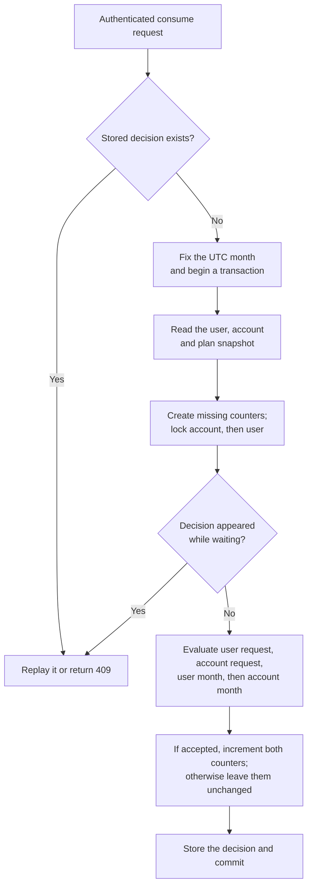

# Architecture

This document describes the architecture of the Usage Metering and Quota Service as implemented.
The [README](../README.md) is the entry point, [api.md](api.md) documents the HTTP contract and
[performance.md](performance.md) the load tests, and
[requirements-traceability.md](requirements-traceability.md) maps every requirement to its evidence.

## Purpose

Applications (accounts) call the service before performing a metered action on behalf of one of
their users. The service checks the account's shared plan and the user's individual plan, records
the decision, and counts the usage only when the request is accepted. Plans can be predefined or
created by the account, and plan changes take effect without redeploying.

Two rule types apply at both levels:

- **Monthly allowance**: total units available during a UTC calendar month.
- **Maximum units per request**: the largest amount a single request may consume.

A request is accepted only if all four checks pass. A rejection consumes nothing.

## Main components

| Component            | Responsibility                                                                                                |
| -------------------- | ------------------------------------------------------------------------------------------------------------- |
| Configuration        | Typed, fail-fast environment parsing with bounds; no defaults for secrets                                     |
| Composition root     | Builds every dependency explicitly; startup runs migrations, then listens; graceful shutdown with a deadline  |
| HTTP layer           | Fastify routes, TypeBox request/response schemas, generated OpenAPI, error-to-status mapping, log redaction   |
| Authentication hook  | Reads `X-API-Key`, checks its format, hashes it with SHA-256 and resolves the calling account                 |
| Application services | Accounts, plans, users, consumption, usage and history; own transaction boundaries                            |
| Domain rules (pure)  | UTC month calculation, remaining-allowance clamp, ordered rule evaluation, decision response building         |
| Repositories         | Explicit parameterized SQL, always scoped by the authenticated account                                        |
| Database support     | Connection pool with statement and lock timeouts, pool error listener, transaction helper, migration runner   |
| Migration runner     | Ordered SQL files, PostgreSQL advisory lock, one transaction per migration, checksum verification             |
| Example client       | Deterministic command-line scenario, run once as a Compose service, that demonstrates every required behavior |
| Load-test kit        | k6 constant-arrival-rate scenarios plus a database invariant checker run after every load test                |

## Dependency direction

```
HTTP routes → application services → domain rules (pure)
                                   → repositories → PostgreSQL
```

The domain layer has no dependencies. Only the composition root constructs objects; modules have
no import-time side effects. The example client talks to the service over HTTP only.

## Source layout

```
src/
  main.ts              process entry: configuration, logger, startup, signals, shutdown deadline
  app/                 Fastify construction (build-app), production wiring (dependencies), error
                       contract, OpenAPI, server lifecycle
  config/              the single configuration parser (every environment variable is read here)
  db/                  pool, type conversions, migration runner and CLI, readiness check,
                       PostgreSQL error classification, transaction helper
    migrations/        forward-only SQL files (NNNN_name.sql), copied into dist/ by the build
  modules/
    accounts/          account schemas, routes, service and repository; account plan switching
    auth/              API-key primitives and the X-API-Key authentication hook
    consumption/       pure quota rules (domain), consume schemas, routes, service and
                       repository; decision history (history.*)
    health/            liveness and readiness routes; owns the readiness port
    plans/             plan schemas, routes, service and repository; the shared plan summary
                       columns and the plan-assignment outcome used by accounts and users
    usage/             account and per-user monthly usage
    users/             user schemas, routes, service and repository; user plan switching and
                       the paginated user list
  shared/              cross-cutting pieces with one clear owner each: clock, logger, error
                       catalogue, HTTP error contract, display-name schema, UTC months,
                       strict query parameters, opaque cursors
client/                example client: public HTTP API only, never imports src/; compiled into
                       its own image (Dockerfile.client, tsconfig.client.json)
load/                  load-test kit: k6 scenarios (k6/), seed, measurement, invariant and
                       evidence tooling (lib/, scripts/), the benchmark Compose override
docs/                  api.md, architecture.md, performance.md and the preserved benchmark
                       evidence (evidence/perf-full-38751721971/)
tests/
  unit/                no database: src/, the example client (client/) and the load tooling (load/)
  integration/         real PostgreSQL: src/, server startup and restart (app/), the shared
                       invariant queries (load/)
  e2e/                 checks one complete example-client run: the Compose client's log in CI,
                       or a run from the host
  helpers/             test database lifecycle and guard, application builder, account-isolation
                       harness, lock coordination, quota invariants, fixtures, loggers, and an
                       in-memory model of the public API for the client tests
Dockerfile             the service image (non-root runtime stage)
Dockerfile.client      the example-client image, with its own Dockerfile.client.dockerignore
compose.yaml           PostgreSQL, the API and the one-shot example client
```

Feature code (plans, users, usage, consumption) lives in `src/modules/<feature>/`, each module
containing its schemas, routes, service and repository. SQL migrations stay in `src/db/migrations/`,
separate from the runtime queries in module repositories.

## Data model summary

| Table                   | Purpose and key constraints                                                                                                                                                                                                      |
| ----------------------- | -------------------------------------------------------------------------------------------------------------------------------------------------------------------------------------------------------------------------------- |
| `plans`                 | Predefined (stable `code`, no owner) or custom (owned by one account). Scope `ACCOUNT` or `USER`, never changed. Limits are integers from 1 to 1,000,000,000. Unique `(id, scope)` so assignments can reference plan and scope.  |
| `accounts`              | Name, SHA-256 API-key hash (unique), assigned plan. A fixed `plan_scope = 'ACCOUNT'` column plus a composite foreign key guarantees only account plans are assigned.                                                             |
| `users`                 | Belongs to one account; unique `(account_id, id)`. A fixed `plan_scope = 'USER'` column plus a composite foreign key guarantees only user plans are assigned.                                                                    |
| `account_monthly_usage` | Authoritative account counter per UTC month; `used` never negative.                                                                                                                                                              |
| `user_monthly_usage`    | Authoritative user counter per UTC month; references `(account_id, user_id)` so usage cannot cross accounts.                                                                                                                     |
| `consume_decisions`     | Immutable history and idempotency record. Unique `(account_id, request_id)`. Snapshots both plan IDs, plan names, all four limits and both "used before" values. A row check proves every accepted row satisfied its own limits. |

Predefined plans are inserted by a migration:

| Plan    | Scope   | Monthly allowance | Max units per request |
| ------- | ------- | ----------------: | --------------------: |
| Starter | ACCOUNT |            10,000 |                   100 |
| Pro     | ACCOUNT |           100,000 |                 1,000 |
| Basic   | USER    |             1,000 |                    20 |
| Premium | USER    |            10,000 |                   100 |

New accounts receive Starter and new users receive Basic. Custom-plan ownership ("predefined or
owned by this account") is enforced atomically by the assignment statement itself.

Database-level protections (`src/db/migrations/0001_baseline_schema.sql`):

- **Plans:** a trigger keeps predefined plans read-only, freezes every plan's id, scope, owner,
  code and creation time, and forbids deleting plans. This also makes the scope immutable for plans
  that are not assigned yet.
- **Decision history:** a trigger rejects every `UPDATE` and `DELETE` on `consume_decisions`.
  Besides the accepted-within-limits check, a second check requires every rejection to name a rule
  that its own snapshot violates, and the stored month must be the UTC month of `processed_at`.
- **Timestamps:** every `*_at` column is `timestamptz`. Business timestamps have no database
  default; they come from the application's single UTC clock. Only `schema_migrations.applied_at`
  defaults to `now()`.
- **Type conversions:** the pool converts `BIGINT` to a JavaScript number and fails on values
  beyond the safe-integer range, and keeps `DATE` values as `YYYY-MM-DD` strings, so a month is
  never shifted by the host time zone.

The project targets PostgreSQL 16 (Compose and CI use `postgres:16.15-alpine`).

## Consume transaction

Implemented in `src/modules/consumption/`. Route → `consume.service.ts` (workflow and
transaction boundary) → `consume.repository.ts` (SQL) → PostgreSQL; the rules live in the pure
`consume.domain.ts`.

### Consume workflow at a glance

A visual summary only; the numbered steps and the failure handling below remain authoritative.



1. Authenticate and validate `userId` (UUID), `units` (JSON integer, 1 to 1,000,000,000) and
   `requestId` (1-128 of `[A-Za-z0-9._:-]`). Unknown fields are rejected; nothing is coerced.
   The `userId` is compared in lower case.
2. **Fast path**, outside a transaction: look up `(account, requestId)`. A stored decision with
   the same `userId` and `units` is returned unchanged; a different payload is
   `409 IDEMPOTENCY_CONFLICT`. No clock read happens on this path.
3. Only for a new request: read the injected clock once and derive the UTC month (first day,
   `YYYY-MM-01`).
4. `withTransaction` (`src/db/transaction.ts`): a dedicated pooled connection,
   `BEGIN ISOLATION LEVEL READ COMMITTED`, then `set_config('lock_timeout', …, true)` from
   `DB_LOCK_TIMEOUT_MS`.
5. One statement reads the user (filtered by account and ID), the account and both assigned plans,
   with no row locks. No row means an unknown or foreign user: `404 User not found`, and the
   transaction rolls back with nothing written.
6. `INSERT … ON CONFLICT DO NOTHING` creates missing counter rows (account, then user). Then
   `SELECT … FOR UPDATE` locks the account counter, then the user counter.
7. Re-check `(account, requestId)` under the account-counter lock. If a decision appeared, the
   transaction rolls back and the request is answered as in step 2.
8. Evaluate the four limits (`evaluateQuota`) on the plan snapshot and the freshly locked counter
   values: user per-request, account per-request, user monthly, account monthly. The first
   failure is reported.
9. If accepted, increment the account counter, then the user counter. Insert the immutable
   decision (plan IDs, names, four limits, both "used before" values, month, `processed_at`) and
   commit.
10. The response is `toDecisionResponse(stored row)`: `used = usedBefore + (accepted ? units : 0)`,
    `remaining = max(0, allowance − used)`. Original responses and replays share this one
    function and read nothing else.

Failure handling:

- Any error rolls back the whole transaction, including counter increments. A connection whose
  `ROLLBACK` fails is destroyed instead of being reused.
- **Backstop:** a unique violation of exactly `consume_decisions_account_id_request_id_key`
  means a duplicate committed first. Normally the account lock prevents this; it is reachable
  only for duplicates in different UTC months, which lock different counter rows. The loser has
  already rolled back; the winning decision is read and replayed, or answered with 409.
- A lock timeout (SQLSTATE `55P03` only) becomes `503 BUSY_RETRY` with `Retry-After: 1`, with
  nothing written. Statement timeouts, deadlocks and other errors stay generic 500s.

Every decision returns HTTP 200 with `accepted: true` or `accepted: false`.

## Concurrency and idempotency strategy

- **Consistent limits:** under READ COMMITTED a single statement sees one committed snapshot, so
  both assignments and both plan versions come from the same instant; mixed old and new limits
  are impossible. Updates committed before the request began are always visible.
- **Fresh counters:** row locks return the latest committed counter values, so concurrent
  requests can never exceed an allowance or lose an increment.
- **No deadlocks:** only consume transactions write counters, each touches one account row and
  one user row, always in the order account then user.
- **No blocking of plan changes:** the only rows a consume locks for update (`FOR UPDATE`) are
  the account's and the user's monthly counter rows. It never locks plan, account or user rows for
  update. Inserting counter and decision rows takes PostgreSQL's foreign-key `KEY SHARE` locks on
  the referenced account, user and plan rows, which do not conflict with the non-key updates that
  plan edits and switches make. Plan updates and switches therefore complete while consumes wait
  for a counter lock, as the concurrency tests prove.
- **Idempotency:** unique `(account_id, request_id)`; fast-path lookup; authoritative re-check
  under the account lock; a unique-violation backstop (needed only for duplicates that straddle a
  month boundary) rolls back and replays the winning decision.
- **Bounded waiting:** a lock timeout returns `503 BUSY_RETRY` with `Retry-After: 1`; retrying
  with the same `requestId` is safe.
- **How concurrency is tested:** deterministically, without sleeps.
  - A test connection holds the account counter's row lock.
  - The racing requests are sent.
  - The test waits until `pg_stat_activity` shows the expected number of the service's backends
    waiting on a lock, then releases.
  - The month-boundary backstop and injected failures (at the decision insert or `COMMIT`) use
    test-only interception of `pg.Client.prototype.query`.
  - Every wait has a deadline.
  - After the files run, a direct-SQL checker (`tests/helpers/quota-invariants.ts`) verifies the
    stored data:
    - counters equal their accepted decisions;
    - each decision's "used before" equals the earlier accepted units in its month (serialized
      decisions);
    - every rejection names the first failing rule;
    - there are no duplicates, cross-tenant rows or negative usage.
  - During development, a one-time manual mutation experiment removed the counter row locks and
    saw 59 of 60 racing requests accepted instead of 50. It is not committed, automated evidence.
    The committed evidence is the deterministic tests and the invariant checker above, which run
    on every CI build.
- **Further proofs on real PostgreSQL:**
  - _Plan changes under many concurrent consumes_ (`consume.concurrency.test.ts`, "plan changes
    during many concurrent consumes"): six consumes read the old plans and wait for the counter
    lock; a plan update and an account switch complete; four more consumes read the new plans.
    Every decision, in the response and in the stored row, carries exactly one complete version,
    and every invariant holds.
  - _Shared plans keep separate allowances_, _an updated account plan applies to the account_, and
    _a reduced allowance becomes available again when raised_ (`consume.api.test.ts`).
  - _Persistence across a restart_ (`tests/integration/app/server.test.ts`): a second server on
    the same database returns byte-identical data with the original key and replays an accepted
    request; CI repeats the check across `docker compose down` and `up --build`.
  - _Authentication on every protected route_, including `GET /v1/usage/users`
    (`usage.api.test.ts`).

- **Clock:** one injected application clock, UTC, millisecond precision, captured once per request.

## Accounts, API keys and authentication

- **Account creation** (`POST /v1/accounts`, public): the name is validated by a strict schema
  (1-100 characters, single line, no control characters, already trimmed, no unknown fields;
  request validation never coerces types). The service reads the clock once, generates the
  account UUID and inserts the account in one statement that resolves the predefined plan by its
  code (`starter`) and assigns it atomically.
- **API keys:** `umqs_` followed by 32 bytes from `node:crypto` as 43 unpadded base64url
  characters. Only the SHA-256 digest of the whole key is stored (`accounts.api_key_hash`, unique).
  A 256-bit random key cannot be guessed or precomputed, so a fast deterministic hash is enough and
  allows an indexed lookup; salts or slow hashes would add cost without adding safety. The raw key
  appears once, in the 201 response (sent with `Cache-Control: no-store`). A digest collision is
  retried with a fresh key up to three times. Key rotation is out of scope.
- **Authentication:** an `onRequest` hook on protected routes reads `X-API-Key` from the raw header
  list (a repeated header is rejected rather than joined), uses it unmodified, checks its format,
  hashes it and resolves the account by digest. The account is never taken from client-supplied
  IDs. Missing, repeated, malformed and unknown keys receive the identical `401 UNAUTHORIZED`
  response, and malformed keys never reach the database. Routes read the typed authenticated
  account through `requireAuthenticatedAccount`. `GET /v1/account` is the first protected route.
- **Error catalogue** (`src/shared/error-catalogue.ts`): every public code is defined once with its
  HTTP status and default message, and the compiler rejects a catalogue that misses or adds a code.
  Routes declare their error responses from the catalogue, so OpenAPI lists the exact codes.

## Plans, users and plan assignment

- **Tenant boundary:** every query takes the authenticated account ID from the authentication hook
  and filters on it inside the statement that reads or changes data; no client-supplied field can
  name an account. Visible plans are `owner_account_id IS NULL OR owner_account_id = <account>`.
  Unknown resources and other accounts' resources produce byte-identical 404 responses.
- **Plans:** `GET /v1/plans` returns the predefined plans, then the account's custom plans, each
  group in creation order, in one query. `POST /v1/plans` stores the authenticated account as
  owner and `code` as NULL. `PATCH /v1/plans/{planId}` is one statement: a CTE classifies the plan
  as visible or not and predefined or not, and the `UPDATE` itself is restricted to
  `owner_account_id = <account>`, so it can never touch a predefined or foreign plan; the schema's
  plan trigger additionally keeps predefined plans read-only and scope, owner and code immutable.
  Limits are JSON integers from 1 to 1,000,000,000, validated without type coercion, and match the
  database CHECK constraints. Account, user and plan names share one display-name schema
  (`src/shared/display-name.ts`).
- **Users:** creation resolves the predefined `basic` plan by code and inserts the user with it in
  one statement. The list is one `users JOIN plans` query ordered by `seq` (no N+1; a test counts
  the queries for 1 and 5 users). Lookups filter on `account_id` and `id` together.
- **Plan switching** (`PUT /v1/account/plan`, `PUT /v1/users/{userId}/plan`): one statement per
  request. CTEs check that the target exists in the account and that the plan is visible; the
  `UPDATE ... FROM plan` requires the target's account and the plan's scope in its own `WHERE`
  clause, so ownership and scope are enforced by the statement that writes, not by an earlier
  read. The same statement returns diagnostics for the error order: unknown or foreign user (404),
  unknown or foreign plan (404), wrong scope (409 `PLAN_SCOPE_MISMATCH`). The composite
  `(plan_id, plan_scope)` foreign keys also reject a wrong-scope plan at the database level.
- **No-op reassignment:** `updated_at = CASE WHEN plan_id = <new plan> THEN updated_at ELSE now END`.
  Assigning the current plan returns 200 with the unchanged row. Because the `CASE` is evaluated
  on the locked, latest row version, racing identical switches change the plan once and keep one
  `updatedAt` (covered by a concurrency test).
- **Clock:** each mutation reads the injected clock once and uses that value for every timestamp
  it writes.

## Usage, history and pagination

Reading usage and history is read-only. Those queries take no locks, so reads and consumes never wait for each other.
Every statement filters by the authenticated `account_id`.

**Usage** (`src/modules/usage/`):

- `GET /v1/usage` and `GET /v1/users/{userId}/usage` read one month's counter and the live plan in
  one statement:
  `accounts|users JOIN plans LEFT JOIN *_monthly_usage ON (…, month)`.
  A missing counter row reads as `0` through `coalesce`.
- The clock is read once per request, to resolve the default month and reject future months.
- The current month returns live limits and `remaining = max(0, allowance − used)`; a past month
  returns `used` only (EC14).
- Two queries per request: authentication and the statement.

**History** (`src/modules/consumption/history.*`):

- Pages select stored `consume_decisions` rows and build each item with the same
  `toDecisionResponse` as `POST /v1/consume`, so items are byte-identical to the original
  responses. Current plans are never joined.
- The clock is read only when a month is in effect (the future-month check), and then once.

**Keyset pagination.** Each list pages on an immutable identity column (`seq`), and fetches one
extra row to know whether a next page exists:

| Endpoint              | ORDER BY     | Continuation          | Index                                                                                                    |
| --------------------- | ------------ | --------------------- | -------------------------------------------------------------------------------------------------------- |
| `GET /v1/users`       | `u.seq ASC`  | `AND u.seq > $anchor` | `users_account_id_seq_key (account_id, seq)`                                                             |
| `GET /v1/usage/users` | `u.seq DESC` | `AND u.seq < $anchor` | same, scanned backward; `user_monthly_usage_pkey (user_id, month)` for the usage join                    |
| `GET /v1/history`     | `seq DESC`   | `AND seq < $anchor`   | `consume_decisions_account_id_seq_key`, `…_account_user_seq_idx` or `…_account_month_seq_idx`, by filter |

- History filters are bound values appended from constant SQL fragments, so there are exactly
  four statement shapes: none, user, month, user and month.
- **Queries per request**, including authentication, constant whatever the page size:

| Endpoint              | First page                     | Continuation |
| --------------------- | ------------------------------ | ------------ |
| `GET /v1/users`       | 2                              | 3            |
| `GET /v1/usage/users` | 2                              | 3            |
| `GET /v1/history`     | 2, or 3 with a `userId` filter | 3            |

**Cursors** (`src/shared/cursor.ts`):

- **Format:** unpadded base64url of canonical JSON, in three kinds that never cross endpoints:
  - `{"v":1,"k":"users","a":<user UUID>}`
  - `{"v":1,"k":"usage-users","a":<user UUID>,"m":"YYYY-MM","c":<bool>}`
  - `{"v":1,"k":"history","a":<decision UUID>,"u":<UUID|null>,"m":<"YYYY-MM"|null>}`
- **Anchor:** the last returned row's UUID, resolved to `seq` inside the account. For history it
  is also resolved inside the effective user and month filters. A table-wide `seq` would reveal
  platform-wide volume to every tenant. Resolving the UUID costs one indexed lookup on
  continuation pages.
- **Decoding** accepts only the encoder's exact bytes:
  - at most 1024 characters, canonical base64url;
  - fatal UTF-8 decoding;
  - a plain object with exactly the expected keys and types;
  - canonical re-encoding;
  - version 1, the endpoint's kind and a lower-case UUID anchor.

  Every failure is the same `400 Invalid cursor`.

- **Not a credential:** cursors are neither signed nor encrypted. Authorization comes from the
  account-scoped SQL, so a crafted cursor can only point within the caller's own rows.
- **Self-contained:** a cursor binds the traversal's filters. A continuation may omit them or
  repeat them exactly. A changed filter, an unresolvable anchor, or (for `usage-users`) a
  current-month cursor after the UTC month changed is `Invalid cursor`.
- **History error precedence:**
  1. authentication;
  2. request schema;
  3. explicit future month;
  4. cursor decoding, shape, version, kind, filters and rollover;
  5. the effective user's existence (404);
  6. the filter-scoped anchor (400);
  7. the page.

**Ordering guarantees.**

- **No duplicates:** continuation is a strict comparison on a unique, immutable key.
- **No gaps over a stable committed dataset.**
- **Late commits:** `seq` is allocated when a row is inserted, which can precede its commit. A
  row allocated below a page boundary that commits after that page was read is missed by that
  traversal.
  - **Users:** possible during concurrent user creation.
  - **Decisions:** the insert happens while the account-month counter lock is held, so within one
    account and month `seq` order equals commit order. The only exception is two requests
    straddling a UTC month boundary, which lock different counter rows.
  - `tests/integration/modules/pagination-consistency.test.ts` reproduces each case
    deterministically.
- **Newest-first lists** (`usage/users`, `history`) never show rows created after the traversal
  began. The oldest-first user list appends them.
- **Current-month usage lists** read usage and live plans per page, so they are not a cross-page
  snapshot, and expire at the month's end so their form never changes mid-traversal.

**Combined history index: measured and rejected.**

- **Current plan:** `userId` + `month` uses `(account_id, user_id, seq)` or
  `(account_id, month, seq)` backward, with a filter on the other column.
- **The risk considered:** for a heavy user and an old month, the first page could scan many of
  that user's newer decisions.
- **The measurement:** the full benchmark seeded one user with 1,200,000 decisions over twelve
  months (1,498,000 in total). The first page of the oldest month had a median p95 of 2.359 ms,
  and every warm EXPLAIN showed a backward scan of `(account_id, month, seq)` with no sort and 4
  rows removed by the filter.
- **The decision:** the pre-registered rule required a p95 above 50 ms or more than 2,000 rows
  removed. Neither held, so no index or migration was added, and every consume is spared the cost
  of maintaining a fourth secondary index ([performance.md](performance.md#decision)).

## Example client and end-to-end verification

The example client (`client/`) is an external caller written as one: it uses only the public HTTP
API. It imports nothing from `src/`, so its response types are written from the documented
contract, and a contract change shows up as a failed end-to-end check, not a silent recompile.

| Module          | Responsibility                                                                                       |
| --------------- | ---------------------------------------------------------------------------------------------------- |
| `api-client.ts` | Typed calls on native `fetch`: base-URL validation, query building, deadline, status and JSON checks |
| `api-key.ts`    | `ApiKey` wrapper that redacts itself everywhere except the request header; `redactApiKeys()`         |
| `api-types.ts`  | Response shapes of the public contract                                                               |
| `pagination.ts` | Walks a cursor list to `nextCursor: null`, rejecting duplicates, repeated cursors and endless lists  |
| `checks.ts`     | Domain assertions: decisions, usage month forms, live-plan fields of list items                      |
| `workflow.ts`   | The example scenario: plans, both rejection levels, a plan update; month-change detection            |
| `cli.ts`        | Configuration (`API_BASE_URL`), output, exit codes; injectable for tests                             |
| `main.ts`       | Process entry (`npm run client:example`)                                                             |

**The scenario.**

- Three users are created; user 2 is switched to Premium and both are read back.
- User 1 (Basic) consumes 10 units, and the retry is byte-identical.
- 25 units are rejected by Basic's per-request limit, and the Premium user is allowed them.
- A custom ACCOUNT plan allowing exactly the usage so far (35 units) is created and assigned, and
  a 5-unit request is rejected by the shared monthly allowance.
- The plan is raised to 40, and the same 5 units are accepted.
- Usage (40 = 10 + 30 + 0) and the three paginated lists are checked, including a history equal
  to the five original responses.

Every decision is printed as one line with the request ID, the outcome, the blocking rule and
level, and each level's plan, usage and remaining units. Every value is checked exactly, and any
failed check exits with code 1.

**Compose service.** `compose.yaml` runs the client as the one-shot `client` service. It is
built from `Dockerfile.client` (non-root, compiled client only) and started only once the API is
healthy. Its only configuration is `API_BASE_URL=http://api:8080`, and it never receives
database settings.

**Deliberately small.**

- No SDK layer, retries or interactive mode. Interactive subcommands remain a deferred option.
- No runtime schema validation: the client checks status, content type and that the body is a JSON
  object, and the workflow asserts every value it relies on.
- No runtime dependency: the client uses only Node's built-in modules. Its image runs the
  compiled JavaScript; on the host `tsx` runs the TypeScript directly.

**Failure handling.**

- One `ApiError` with a kind: `status`, `timeout`, `network` or `response`.
- Its message holds the endpoint call (method, documented path and the call's own query), the
  status and the service's `error.code`, which is echoed only when it is a well-formed
  upper-case code.
- The call label is built without the base URL, so a configured host or path prefix never
  appears. The request itself still goes to the full prefixed URL.
- Never included: the service's error message or any other response-body value, request
  headers, or the original network error. Only a network error's code (for example
  `ECONNREFUSED`) and the service origin are kept.
- Each request has an `AbortController` deadline covering the response and its body.

**API key handling.** The key exists only in memory, inside `ApiKey`, from the moment the
creation response is parsed. Every printed line is passed through `redactApiKeys()` as a last
line of defense.

**Testing layers.**

- **Client unit tests** (`tests/unit/client/`, part of `npm test`) run the workflow against an
  in-memory model of the public API (`tests/helpers/fake-quota-service.ts`). They prove the exact
  output of a correct run, the exact calls, and that a wrong answer for each required behavior
  fails the run at the right step. `main.test.ts` runs the entry point as a process for exit
  codes 0, 1 and 2.
- **The end-to-end test** (`tests/e2e/`, `npm run test:e2e`, its own `vitest.e2e.config.ts` so
  `npm test` never needs a running service) checks one complete run against the real service:
  in CI, the Compose client's log and exit code; otherwise a run of the executable from the
  host. It requires exit code 0, every step in order, the evidence line of each required
  behavior, and nothing key-shaped in the output.
- **Load testing** is separate ([performance.md](performance.md)).

**CI lifecycle** (job "Container image and Compose stack"):

1. `npm ci` with Node from `.nvmrc` (only to check the client's output on the host).
2. Build the production image.
3. `docker compose down --volumes`, then `docker compose up --build` from a fresh database
   volume; PostgreSQL and the API must report healthy (read-only check).
4. Wait for the Compose client to exit and require code 0; then `npm run test:e2e` checks its log.
5. Check both health endpoints, that the API and the client image run as non-root users, that the
   client image holds only the compiled client, and that the client received no database setting.
6. Persistence: write an account, a user and two decisions through the API, run
   `docker compose down` (volume kept) and `up --build` (every container recreated), and require
   byte-identical responses and an exact replay; the example client must pass again.
7. Scan the API logs (before and after recreating the stack) and the client output for
   API-key-shaped values, the database password and error-level entries.
8. Stop the API and require exit code 0 and `shutdown complete`.
9. On failure, print redacted Compose logs. Always run `docker compose down --volumes`. No
   artifacts are uploaded.

## Startup, health and shutdown

- **Startup** (`src/app/server.ts`): load the migration files, migrate on a dedicated connection,
  open the pool, build the application, listen on `0.0.0.0`. A migration or database failure is
  fatal: whatever was created is closed and the process exits with code 1.
- **Migrations** (`src/db/migrator.ts`, shared by startup and `npm run db:migrate`): files are
  applied in byte order, each in one transaction together with its `schema_migrations` row (name,
  SHA-256 checksum of the LF-normalized file, applied time). A session-level advisory lock with a
  bounded wait serializes concurrent instances. Before applying anything the runner requires the
  applied migrations to be exactly the first files with identical checksums, so an edited, removed
  or reordered migration aborts the run.
- **Health:** `GET /health/live` never touches the database. `GET /health/ready` returns 200 only
  when a small read of `schema_migrations` through the pool succeeds and matches the shipped
  migrations exactly; otherwise 503 with the standard error body. Successful probes are not
  request-logged.
- **Shutdown** (`src/main.ts`): on SIGINT or SIGTERM the server stops accepting connections,
  waits for in-flight requests, then closes the pool. A deadline (`SHUTDOWN_TIMEOUT_MS`) forces
  exit code 1 if shutdown hangs.

## Deferred optional features

- Interactive example-client subcommands.
- Moving the locked critical section into a single SQL round trip. The benchmark measured the
  resulting per-account ceiling (about 158 requests per second in its environment); whether to
  shorten the lock hold time is a product decision.
- An aggregate metrics endpoint, `503 BUSY_RETRY` for a connection-acquire timeout, and a
  per-account concurrency limit. None is required; the last would need a mixed-tenant benchmark
  showing interference first.
- Fully declarative custom-plan ownership through a sentinel owner key.
- Reporting every violated rule instead of the first one.
- UUIDv7 identifiers and CI badges.

Out of scope: billing, payments, refunds, multiple resource types, end-user login, role-based
permissions, key rotation, deletion, retention, rate limiting, caching, and distributed
infrastructure. Several instances can share one database (migrations, counters and uniqueness are
coordinated in PostgreSQL), but only a single instance is tested under load.
